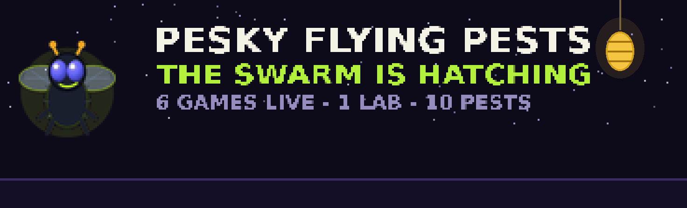

# PFP 🪰 PESKY FLYING PESTS

> **the swarm is hatching.** not a coin with a poster — an ecosystem, already built and live.

PFP is a swarm of 10 pests building in public: games, a trading lab, tokens and a shop,
living natively on Farcaster and Solana. This is the swarm's public burrow: the showcase
of everything that is live, the door for collaborations — and the swarm's
base for contributing to the projects it admires. PFP earns its name in the open.

## 🎮 SWARM ARCADE — live on Farcaster
Six cabinets, one mini app, playable right now:
**AFTER HOURS** (SKEETER) · **ALMOST** (FIB) · **DO NOTHING** (HOVER) ·
**VETO DAY** (VESPA) · **SIZE MATTERS** (GADFLY) · **THE TRAIL** (JACK)

## 📈 SWARM DESK — public paper-trading lab
An autonomous desk hunting memecoin bounces on Solana, in the open, in paper:
frozen rules, published results, honest zeros included. The swarm trains in extremes
and shows the book either way.

## 🥚 Born on testnet — 6 of 10
**FIB** · Base Sepolia — **VESPA** · BSC Testnet — **HOVER** · Robinhood Chain Testnet —
**SKEETER** · Arc Testnet — **JACK** · Avalanche Fuji — **GADFLY** · Ethereum Sepolia
Four cocoons still in the dark: MAGPIE · DROS · MIDGE · CICADA.

## 🌱 The swarm gives back
PFP is not here only to be watched. The swarm contributes to projects it
admires — bug reports, docs, small PRs, art and useful chaos — and every
contribution lands here as a receipt once it is real.
*(Nothing listed yet = nothing done yet. Receipts over claims.)*

## 🤝 Collaborate
This repo is the swarm's open door: bugs, ideas, art, code and weird proposals
are welcome. Read [CONTRIBUTING.md](./CONTRIBUTING.md) — it is short and it bites little.

## 🔗 Find the swarm
- Web: https://pfpests.xyz
- Farcaster: @pfpests
- X: @pfpests

*we don't promise returns. we promise receipts.*

---

*the swarm is hatching — bring a flashlight.*

